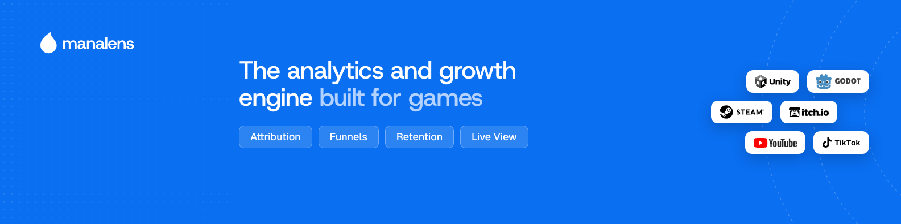

Manalens makes analytics and growth simple, so you can focus on making amazing games.

Manalens is available through our [web SDK](https://github.com/manalens/manalens-js), [Godot plugin](https://github.com/manalens/manalens-godot), [Unity package](https://github.com/manalens/manalens-unity), and [HTTP API](https://docs.manalens.dev).

## Features

- 📊 **Analytics:** a unified view of your website, game, and Steam page
- 🔴 **Live View:** watch player activity in realtime
- 🐞 **Error Tracking:** crash and exception reporting from the game client
- 🧭 **Attribution:** see which channels and creators bring players
  - 🎯 Steam attribution: UTM-tagged store links, wishlists, and purchases by campaign
  - 🛒 itch.io attribution: purchases and donations matched to the source of each sale
  - 🚀 Install attribution: each first game launch credited to the website visit that came before it
- 🔻 **Funnels:** find where players drop off
- 🗺️ **User Journeys:** follow the paths players take
- 👥 **Audiences:** know your players
- 🔁 **Retention:** D1, D7, and D30 cohorts and returning players
- 🖱️ **Custom Events:** track the actions you define
- 🪪 **Profiles:** see each player's activity and traits
- 🎮 **Sessions:** explore play sessions
- 🧩 **Dashboards:** build custom reports
- ✨ **Ask AI:** ask questions about your data
- 🗄️ **SQL Explorer:** query and export your data
- 🤖 **MCP Server:** connect your analytics to AI agents, with a one-prompt install for Cursor, Claude Code, and Codex
- 🔌 **API:** query and ingest with REST
- 🔒 **Privacy first:** first-party anonymous IDs, optional consent mode, no raw IP addresses stored

## SDKs

| SDK | Use it for | License |
| --- | --- | --- |
| [manalens-js](https://github.com/manalens/manalens-js) | Your game website and web games | MIT |
| [manalens-godot](https://github.com/manalens/manalens-godot) | Godot 4 games (plain GDScript) | MIT |
| [manalens-unity](https://github.com/manalens/manalens-unity) | Unity games (no dependencies) | MIT |

## Links

- [Website](https://manalens.dev)
- [Documentation](https://docs.manalens.dev)
- [Install guides](https://manalens.dev/integrations)
- [Examples](https://github.com/manalens/examples)
- [Changelog](https://manalens.dev/changelog)
- [Status](https://status.manalens.dev)

## Get help

Have a question or feedback? [Chat with us](https://manalens.dev/support) or [book a demo](https://cal.com/manalens/demo).
